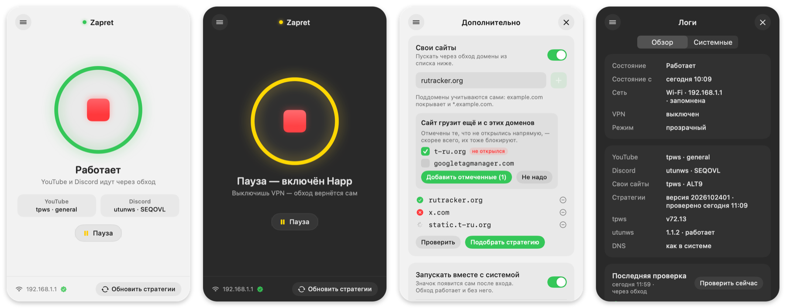

<div align="center">

# zapret-mac

**YouTube и Discord на macOS без VPN — на движке [zapret](https://github.com/bol-van/zapret).**
Приложение в строке меню и bash-скрипт под ним. Само переключается, когда включаешь и выключаешь VPN.

[](https://github.com/getpaintoo/zapret-mac/actions/workflows/ci.yml)
[](LICENSE)


[Приложение](#приложение-zapret) · [Установка](#установка) · [Как это работает](#как-это-работает) · [Как обходится блокировка](#как-обходится-блокировка) · [Если пропал интернет](#если-пропал-интернет)

</div>

---

На Windows есть готовая сборка [Flowseal/zapret-discord-youtube](https://github.com/Flowseal/zapret-discord-youtube). На macOS она не запускается: winws и драйвер WinDivert существуют только для Windows. zapret-mac берёт два движка, которые на macOS работают: tpws из zapret для YouTube и utunws из [macOS-порта Flowseal](https://github.com/Flowseal/zapret-mac-discord-youtube) для Discord. Вокруг них — прозрачное перенаправление через pf, подбор стратегий, автозапуск и сторож, который уступает дорогу VPN.

> **Новое в 3.0:** приложение Zapret в строке меню, стратегии в отдельном файле с обновлением с GitHub, 19 стратегий utunws для Discord вместо трёх, пауза с таймером, стратегии для каждой сети и проверка после пробуждения. Подробности — в [CHANGELOG.md](CHANGELOG.md).

## Приложение Zapret

<p align="center"></p>

Значок в строке меню показывает, что с обходом: **▶ зелёный** — работает, **⏸ жёлтый** — пауза (включён VPN или пауза вручную), **■ красный** — выключен. Щелчок открывает панель:

- **главная кнопка** — подобрать стратегии и включить обход, повторное нажатие выключает. Сначала за секунды проверяются сохранённые стратегии, полный подбор — только если они не работают;
- **пауза** на 15 минут, час или пока не снимешь;
- **«Обновить стратегии»** — свежий `strategies.conf` с GitHub и списки доменов Flowseal. Служба обновляет их и сама, раз в сутки;
- **шторка ≡**: «Дополнительно» — свои сайты (приложение само находит домены, с которых сайт грузит картинки и скрипты), запуск вместе с системой, тема, DNS, обновление приложения, удаление; «Логи» — состояние, последняя проверка и журналы службы.

Обход работает и без приложения: его делают системные службы, приложение только показывает состояние и запускает команды скрипта.

## Возможности

- **Прозрачный режим, как в оригинальном zapret.** pf перенаправляет исходящий TCP на порты 80 и 443 в tpws, поэтому обход видят все программы. В том числе апдейтер Discord: он написан на Rust и системный SOCKS-прокси игнорирует.
- **Discord через utunws — с поддельными пакетами, как на Windows.** utunws — это nfqws из zapret, который получает пакеты через интерфейс `utun` и отправляет их через BPF. Поэтому он может делать то же, что winws на Windows: отправлять поддельные пакеты и пересобирать TLS-приветствие. Через него же идёт голос по UDP. Выключается в настройках (пункт 9 → 5).
- **Подбор под каждую сеть.** Для Discord подбирается одна из 19 стратегий utunws (пресеты Flowseal), для YouTube — одна из 16 стратегий tpws, а если tpws открывает не всё, ещё и вариант через utunws. Подобранное запоминается для каждой сети по MAC шлюза: вернулся домой или включил раздачу с телефона — сразу ставятся стратегии этой сети.
- **Стратегии обновляются.** Они лежат в `strategies.conf`, и служба раз в сутки скачивает свежий с GitHub. Скрипт принимает только знакомые опции без путей к файлам, а tpws и utunws должны принять каждую стратегию.
- **Автопереключение с VPN.** Сторож ловит события маршрутизации. VPN в режиме TUN включился — перенаправление снимается, весь трафик идёт в VPN. Выключился — обход возвращается.
- **Самопроверка.** Раз в 30 минут, после смены сети и после пробуждения Mac сторож открывает YouTube и Discord. Если перестали открываться, подбирает стратегии в фоне и присылает уведомление.
- **Подбор при включённом VPN.** Тестовый трафик уходит к провайдеру напрямую через Wi‑Fi, мимо туннеля. Перед подбором скрипт сверяет внешний IP, чтобы проверка правда шла мимо VPN.
- **QUIC к Google блокируется.** Браузер сразу идёт по TCP, то есть через обход. Адреса Google Cloud не трогаются: на них бывают VPN-серверы.
- **Безопасные отказы.** Если якорь pf внутри `com.apple` не срабатывает, скрипт прописывает свой в `/etc/pf.conf`, как установщик zapret. Если прозрачный режим не работает совсем, переходит на SOCKS-прокси. Если tpws упал, перенаправление снимается, чтобы не пропал интернет.
- **Проверенные движки.** tpws скачивается из релиза bol-van/zapret, utunws — из релиза Flowseal. Контрольные суммы SHA-256 сверяются с зашитыми в скрипт.

## Что работает

| | Через обход | Через VPN |
|---|:---:|:---:|
| YouTube в браузере | ✓ | ✓ |
| Обновления Discord | ✓ | ✓ |
| Приложение Discord | ✓ через utunws | ✓ |
| Звонки в Discord (UDP) | ✓ через utunws | ✓ |

Проверено с выключенным VPN на домашнем провайдере и на мобильном интернете МегаФона (раздача с iPhone) в октябре 2026 года. Провайдеры меняют блокировки: если что-то перестало открываться, нажми «Обновить стратегии» или напиши в [Issues](https://github.com/getpaintoo/zapret-mac/issues).

VPN определяется по маршруту через туннель (`utun`, `ipsec`, `wg`…), поэтому подходит любой клиент в режиме TUN: Happ, AmneziaVPN, Incy, V2Box, WireGuard и другие.

## Установка

Нужны macOS 14 или новее и пароль администратора. Остальное (bash 3.2, curl, pfctl, launchd) уже есть в системе. tpws, utunws и приложение собраны для Intel и Apple Silicon; проверено на macOS 26.4 с Apple Silicon.

### Приложение

1. Скачай `Zapret.zip` из [последнего релиза](https://github.com/getpaintoo/zapret-mac/releases/latest), распакуй и перетащи `Zapret.app` в «Программы».
2. Приложение подписано без сертификата Apple, поэтому первый раз открой его правой кнопкой → «Открыть» (или разреши в «Системные настройки → Конфиденциальность и безопасность»).
3. В панели нажми **«Установить»**. macOS один раз спросит пароль: приложение ставит службу в `/opt/zapret-mac` и правило `/etc/sudoers.d/zapret-mac`, по которому дальше запускает без пароля только скрипт службы. Он принадлежит root, так что подменить его, не зная пароля, нельзя; но любая программа под твоим пользователем сможет включать и выключать обход.
4. Нажми большую кнопку ▶.

Собрать приложение самому (хватает Command Line Tools, Xcode не нужен): `bash app/build.sh install`.

### Только скрипт

```bash
curl -fLO https://raw.githubusercontent.com/getpaintoo/zapret-mac/main/zapret-mac.sh
bash zapret-mac.sh
```

В меню выбери **1 — Подобрать стратегии и включить**. Запускать через `sudo` не нужно: пароль скрипт спросит сам. При первом запуске он ставит себя в `/opt/zapret-mac` и кладёт на рабочий стол ярлык `Zapret.command`.

## Меню скрипта

| № | Что делает |
|---|---|
| 1 | Подобрать стратегии и включить |
| 2 | Включить с сохранёнными стратегиями |
| 3 | Выбрать стратегии вручную (отдельно для YouTube и Discord) |
| 4 | Выключить |
| 5 | Проверить, что открывается: напрямую и через обход |
| 6 | Перезапустить Discord |
| 7 | Добавить свой сайт в обход |
| 8 | Автосписок сайтов |
| 9 | Настройки: QUIC, автоподбор, режим, автосписок, utunws для Discord |
| 10 | DNS Google/Cloudflare: вкл/выкл |
| 11 | Подробный статус и журнал сторожа |
| 12 | Перебрать все стратегии |
| 13 | Обновить tpws, utunws и списки доменов |
| 14 | Удалить всё |

Без меню:

```bash
bash zapret-mac.sh auto        # подобрать и включить
bash zapret-mac.sh check       # что открывается
bash zapret-mac.sh status      # подробный статус
bash zapret-mac.sh stop        # выключить
```

Также есть `start`, `restart`, `test [all]`, `discord`, `add`, `dns`, `update`, `uninstall` и команды, которыми пользуется приложение: `on`, `off`, `pause МИНУТ`, `resume`, `info`, `check-now`, `update-strategies`, `site-add`, `sites-select`.

## Как это работает

```
 программа ── TCP 80/443 ──▶ pf: route-to lo0 → rdr ──▶ tpws :988 ──▶ провайдер
                                                      │
                                    стратегия только для доменов из списков,
                                    остальные сайты проходят без изменений

 Discord ── TCP к его адресам, голос по UDP ──▶ pf: route-to utun50 ──▶ utunws
              utunws: поддельный ClientHello + настоящий ──▶ BPF ──▶ провайдер

 VPN (TUN) включён ──▶ сторож снимает правила pf ──▶ весь трафик идёт в VPN
```

- **tpws** работает от root как LaunchDaemon `com.zapret-mac.tpws`. На macOS адрес назначения из pf отдают только root, это ограничение описано в [docs/bsd.md](https://github.com/bol-van/zapret/blob/master/docs/bsd.md) zapret.
- **Правила pf** — из той же документации. Трафик root не перенаправляется, иначе tpws завернул бы сам себя. Локальные сети не трогаются.
- **utunws** — LaunchDaemon `com.zapret-mac.utunws`. Открывает интерфейс `utun50` и пишет пакеты прямо в Wi‑Fi или Ethernet через BPF, поэтому ему нужен MAC шлюза. После запуска работает от `nobody`. pf отдаёт ему только адреса Discord (`162.159.128.0–162.159.139.255`) и порты голоса.
- **Сторож** — LaunchDaemon `com.zapret-mac.watchdog`, тот же скрипт с командой `daemon`. Читает `route -n monitor` и раз в 5 секунд сверяет, что pf, tpws и utunws в порядке. Сменилась сеть — перезапускает utunws с новым шлюзом.
- **Списки доменов** — из Flowseal: `list-youtube.txt` (у Flowseal это `list-google`) и `list-general.txt`. Свои сайты — в `list-user.txt`.

Подробно: [docs/architecture.md](docs/architecture.md).

## Как обходится блокировка

Провайдер смотрит на начало каждого HTTPS-соединения: там открытым текстом видно имя сайта, например `discord.com`. Если имя в чёрном списке, соединение не пропускается. Обход сбивает эту проверку, и способ зависит от сети:

- **tpws** режет TLS-приветствие на части и меняет их порядок, так что имя целиком не видно. Этого хватает для YouTube у большинства домашних провайдеров.
- **utunws** работает с пакетами напрямую и умеет больше. Например, перед настоящим приветствием отправляет поддельное с именем `www.google.com`, которое сервер выбросит (`fake`). Или накладывает на начало приветствия чужие данные (`seqovl`).

Провайдеры относятся к этим приёмам по-разному. На домашнем провайдере Discord проходит и с `fake`, и с `seqovl`, а мобильный МегаФон пропускает только `seqovl`. YouTube на МегаФоне через tpws почти не открывается, а через utunws (`hostfakesplit`) открывается целиком. Поэтому подбор проверяет варианты на текущей сети и оставляет те, с которыми всё открывается.

Подробно, вместе с правилами pf: [docs/architecture.md](docs/architecture.md#utunws).

## Если пропал интернет

```bash
sudo bash /opt/zapret-mac/zapret-mac.sh stop
```

Команда снимает правила pf, останавливает tpws, utunws и сторожа, выключает системный прокси, если его ставил скрипт. Если и скрипта под рукой нет, правила можно снять вручную (смотря куда они загружены):

```bash
sudo pfctl -a com.apple/zapret-mac -F all
sudo pfctl -a zapret-mac/zapret-mac -F all
```

## Удаление

В приложении: «Дополнительно → Удалить zapret-mac», затем перетащи `Zapret.app` в корзину. Без приложения — пункт 14 в меню или `bash zapret-mac.sh uninstall`. Убирается всё: `/opt/zapret-mac`, все три LaunchDaemon, правило sudo, правки `/etc/pf.conf`, ярлык. DNS возвращается к прежнему, если его менял скрипт.

## Где что лежит

| Путь | Что там |
|---|---|
| `/opt/zapret-mac/zapret-mac.sh` | установленная копия скрипта |
| `/opt/zapret-mac/bin/tpws` | tpws из релиза zapret |
| `/opt/zapret-mac/bin/utunws` | utunws и поддельные пакеты для него (`*.bin`) из релиза Flowseal |
| `/opt/zapret-mac/strategies.conf` | стратегии tpws и utunws, обновляются с GitHub |
| `/opt/zapret-mac/networks/` | стратегии, которые сработали в каждой сети |
| `/opt/zapret-mac/lists/` | списки доменов; свои сайты — `list-user.txt`, исключения — `list-exclude-user.txt` |
| `/opt/zapret-mac/config` | настройки: режим, стратегии, QUIC, автоподбор, автосписок, utunws |
| `/opt/zapret-mac/log/` | `watchdog.log` — журнал сторожа, `tpws.log`, `utunws.log`, `select.log` — ход последнего подбора, `update.log` — обновления стратегий |
| `/opt/zapret-mac/run/` | состояние для приложения: `status`, `check`, `progress`, `events`, `pause` |
| `/Library/LaunchDaemons/com.zapret-mac.*.plist` | автозапуск tpws, utunws и сторожа |
| `/etc/sudoers.d/zapret-mac` | правило, по которому приложение запускает скрипт без пароля |
| `/Applications/Zapret.app` | приложение в строке меню |

## Обновление со старой версии

Первая версия жила в `~/.zapret-mac` и работала как SOCKS-прокси. Новая при установке сама её останавливает, снимает прокси и переносит свои сайты, выбранную стратегию и сохранённые настройки DNS. История изменений — в [CHANGELOG.md](CHANGELOG.md).

## Участие

Ошибки и предложения — в [Issues](https://github.com/getpaintoo/zapret-mac/issues). Перед pull request прочитай [CONTRIBUTING.md](CONTRIBUTING.md): скрипт должен работать на системном bash 3.2.

## Благодарности

- [bol-van/zapret](https://github.com/bol-van/zapret) — tpws и правила pf для macOS.
- [Flowseal/zapret-discord-youtube](https://github.com/Flowseal/zapret-discord-youtube) — списки доменов и сама идея набора стратегий.
- [Flowseal/zapret-mac-discord-youtube](https://github.com/Flowseal/zapret-mac-discord-youtube) — utunws, стратегия simple-fake и поддельные пакеты для Discord.

## Лицензия

[MIT](LICENSE). Лицензии использованных проектов — в [THIRD_PARTY_NOTICES.md](THIRD_PARTY_NOTICES.md).

Скрипт меняет сетевые настройки macOS (pf, launchd, системный прокси) и предоставляется как есть, без гарантий.

---

<details>
<summary><b>English</b></summary>

zapret-mac brings [zapret](https://github.com/bol-van/zapret) DPI circumvention for YouTube and Discord to macOS, with a menu bar app (green ▶ running, yellow ⏸ paused for a VPN or manually, red ■ off) on top of a bash script. It runs tpws as a transparent proxy behind pf for YouTube and [Flowseal's](https://github.com/Flowseal/zapret-mac-discord-youtube) utunws (nfqws reading packets from a utun interface and writing them out through BPF) for Discord, picks tpws strategies for YouTube and Discord, starts on boot via launchd, and a watchdog turns the redirection off while a TUN VPN is up and back on when it goes down.

Install: download `Zapret.zip` from the latest release, move `Zapret.app` to Applications and press «Установить» (asks for the admin password once). Script only: `curl -fLO https://raw.githubusercontent.com/getpaintoo/zapret-mac/main/zapret-mac.sh && bash zapret-mac.sh`, then choose 1 in the menu.

Discord goes through utunws, YouTube through tpws or utunws; the strategy selection tests the options on the current network (home ISP or a mobile hotspot) and keeps the ones that open everything. The Discord app, chats and voice calls work without a VPN. Details: [docs/architecture.md](docs/architecture.md#utunws) (in Russian).

</details>
